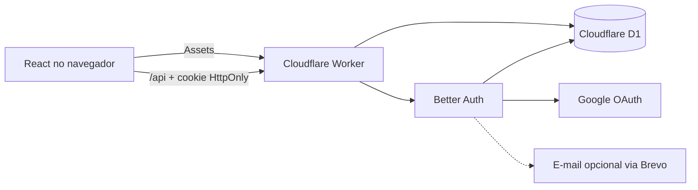

# Organizador de Tarefas Pro

[Acessar a aplicação](https://organizador-de-tarefas.rafaelmikilin.workers.dev)

Organizador pessoal de estudos, trabalho e rotina, com tarefas, Kanban e Pomodoro. React 19 + Vite + Tailwind CSS 4 no frontend; Cloudflare Workers + D1 + Better Auth na API.

A interface usa a direção **Editorial greeting** da Taste Skill: tipografia Instrument Sans, superfícies opacas e a paleta original adaptada em dois temas: Violeta e Noturno, com destaque lilás nas ações e no progresso. A aplicação mantém os recursos existentes de prioridades, tags, subtarefas, recorrência, notas, busca, exportação Excel/PDF e alertas.

Os botões usam pares de cores de fundo e texto próprios de cada tema. Os atalhos aparecem junto às ações: **N** para nova tarefa, **/** para buscar, **Enter** para adicionar, **Ctrl/⌘ + Enter** para salvar no formulário de tarefa e **Esc** para fechar o diálogo ou limpar a busca. Os atalhos de criar e buscar respeitam campos em edição; a navegação por Tab permanece dentro do diálogo aberto.

## Arquitetura



Frontend e API compartilham a origem. Não há dependência de Render, Vercel ou Supabase no runtime novo. O script de backup usa o Supabase antigo apenas para exportação de leitura.

A entrada principal é pelo Google. Depois do primeiro acesso, **Minha conta → Senha** permite criar uma senha própria para a mesma conta, sem duplicar tarefas. Alterar uma senha já criada exige a senha atual. Uma sessão recente e autenticada é necessária para criar a primeira senha.

As sessões ficam em cookies HttpOnly, SameSite=Lax e Secure em HTTPS. O navegador guarda apenas um cache do perfil, sem token de autenticação no localStorage. Todas as consultas de tarefas usam o ID da sessão; alterações em IDs pertencentes a outra conta retornam 404. Exclusão de conta remove tarefas e sessões por chave estrangeira.

## Executar localmente

Requer Node.js 22.12+ e npm. No PowerShell que bloqueia `npm.ps1`, use `npm.cmd` e `npx.cmd`.

```sh
npm --prefix frontend ci
npm --prefix backend ci
```

Copie `.dev.vars.example` para `.dev.vars` **na raiz**, gere um segredo e substitua o valor de exemplo:

```sh
node -e "console.log(require('node:crypto').randomBytes(48).toString('hex'))"
npm run db:local
npm run dev
```

Abra **http://localhost:8787**. O Wrangler constrói o frontend e serve a aplicação e a API com D1 local; mudanças em `frontend/src` e `backend/src` recompilam a aplicação.

`DEV_AUTH_EMAILS=true` dispensa a confirmação de e-mail **somente em localhost**. Nesse ambiente, cadastre uma conta e entre diretamente. A recuperação por e-mail requer um provedor configurado; o modo local não envia mensagens nem simula entrega. O banco local fica em `.wrangler/`, separado do banco remoto.

Para usar o Vite com atualização instantânea, deixe o Worker em execução e rode em outro terminal:

```sh
npm --prefix frontend run dev
```

Abra http://localhost:5173. O proxy de `/api` encaminha as chamadas ao Worker local. `VITE_API_URL=/api` é o padrão; segredos nunca devem ser definidos em variáveis `VITE_`.

## Migrar suas tarefas do Supabase

**Não apague o projeto antigo antes de conferir o backup e a importação em produção.** A migração não transporta a senha nem sessões antigas; crie sua conta no novo aplicativo, de preferência com o mesmo e-mail.

O arquivo antigo `backend/.env` pode ser mantido localmente para o backup:

```env
SUPABASE_URL=https://seu-projeto.supabase.co
SUPABASE_SERVICE_ROLE_KEY=sua-chave-administrativa
SUPABASE_USER_EMAIL=seu-email-de-login
# Alternativa para identificar a conta:
# SUPABASE_USER_ID=uuid-da-sua-conta
```

```sh
npm --prefix backend run backup:supabase
```

O script consulta somente as tarefas da conta selecionada, com paginação. Salva um JSON em `backups/`, ignorado pelo Git. Se houver mais de uma conta e não houver e-mail ou ID, ele interrompe a exportação.

Na aplicação nova, entre na sua conta e abra **Exportar → Importar backup JSON**. O importador preserva título bruto, notas, subtarefas, recorrência, datas, status e data de criação. A propriedade das tarefas passa para a sessão atual, sem confiar em um `user_id` recebido do navegador. Reenviar o mesmo backup não duplica tarefas. O arquivo pode ter até 2 MB, processado em lotes de até 500 tarefas. Se houver interrupção, reenvie o backup; os lotes já concluídos são reconhecidos.

**Salvar backup JSON** exporta todas as tarefas da conta, inclusive as ocultas por um filtro. Excel e PDF continuam exportando a visualização filtrada. Guarde o JSON para restauração; as planilhas são relatórios.

## Publicar no Cloudflare

A configuração está em `wrangler.jsonc`. O banco `organizador-tarefas` já foi criado na conta configurada e as duas migrações já foram aplicadas. O ID real está vinculado ao binding `DB`. O aplicativo está publicado em https://organizador-de-tarefas.rafaelmikilin.workers.dev. Os passos de criação abaixo servem para instalar em outra conta; não recrie o banco existente.

1. Autentique e crie o banco no plano Free:

```sh
npm run cloudflare -- login
npm run cloudflare -- d1 create organizador-tarefas
```

2. Copie o `database_id` retornado para `wrangler.jsonc` e aplique as migrações:

```sh
npm run db:remote
```

3. Configure os segredos, sem colocá-los em arquivos versionados:

```sh
npm run cloudflare -- secret put BETTER_AUTH_SECRET
npm run cloudflare -- secret put APP_URL
```

`APP_URL` é a origem pública exata do aplicativo. Use um segredo aleatório com pelo menos 32 caracteres. Não configure `DEV_AUTH_EMAILS` em produção.

4. Valide e publique:

```sh
npm run check
npm run deploy
```

O build do frontend é executado automaticamente pelo Wrangler. Assets são servidos pelo Cloudflare; `/api/*` chega ao Worker e caminhos de navegação usam o fallback de SPA. Um domínio próprio é opcional.

Entre com Google na URL pública, importe o JSON e confira contagem, prazos, notas e checklist. Só depois desative as hospedagens antigas. O código não ativa assinatura paga nem altera o Supabase remoto.

### Plano gratuito e limites

Em 30/10/2026, a documentação informa 100 mil requisições de Worker por dia e 10 ms de CPU por requisição no Free. O D1 Free inclui 5 milhões de linhas lidas/dia, 100 mil escritas/dia e 5 GB no total. São limites de uso, não garantia de gratuidade ilimitada. Assets estáticos têm tratamento separado das requisições dinâmicas.

Autenticação com senha é a parte mais exigente em CPU. Esta configuração usa a implementação nativa de `scrypt` disponibilizada pelas versões instaladas do Better Auth para `workerd`, com `nodejs_compat`. **O teste local não certifica o limite de CPU do Free em produção**: verifique cadastro e login na conta real antes de desligar o sistema antigo. Não reduza a segurança da senha para contornar limites; se necessário, avalie login por provedor externo, como Google, antes de optar por plano pago.

O acesso por Google e a criação de senha após esse acesso dispensam serviço de e-mails. Cadastro direto por e-mail e recuperação de senha por mensagem dependem de um serviço de envio. O Brevo é configurado separadamente e sujeito à cota/plano da sua conta; Cloudflare Workers não inclui esse envio automaticamente.

Fontes: [Workers e preços](https://developers.cloudflare.com/workers/platform/pricing/), [D1 e preços](https://developers.cloudflare.com/d1/platform/pricing/), [SPA no Workers](https://developers.cloudflare.com/workers/static-assets/routing/single-page-application/), [Better Auth](https://better-auth.com/docs/reference/security).

## Validação

```sh
npm run check
npm --prefix backend run deploy:check
```

Os testes unitários validam datas, status e campos de tarefa. Para rodar também a integração com cadastro, cookies, CRUD, isolamento de duas contas, importação repetida e exclusão em cascata, inicie o Worker local e rode:

```powershell
$env:TEST_BASE_URL='http://localhost:8787'
npm --prefix backend test
```

O teste de integração recusa URLs remotas, cria contas temporárias locais e as exclui ao terminar. A inspeção visual da Taste Skill gera seus relatórios e imagens em `.taste-skill/`, ignorado pelo Git.

## Licença

[MIT](LICENSE).
